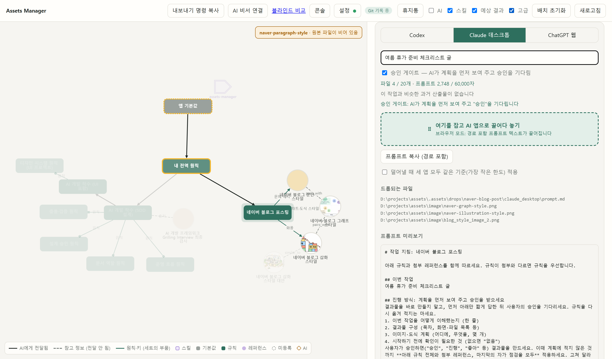
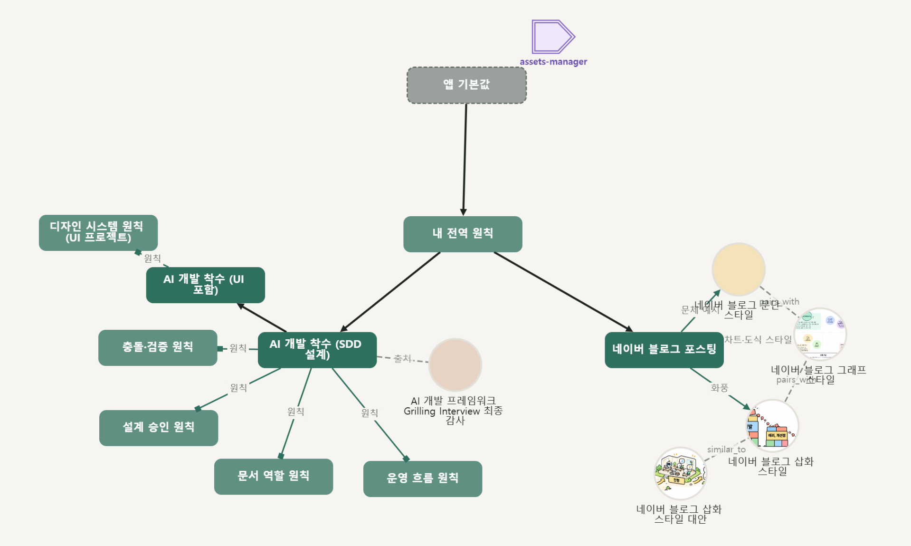
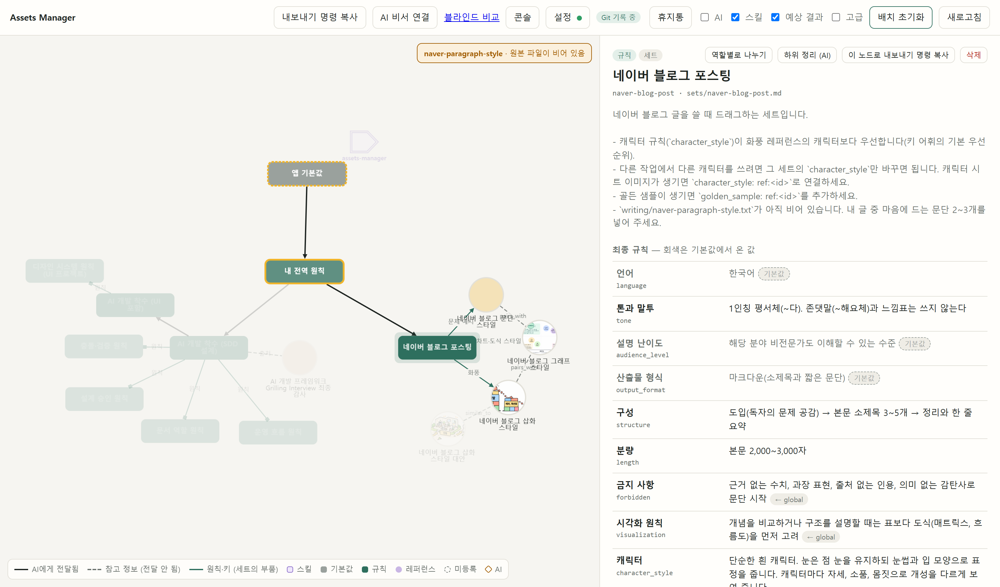
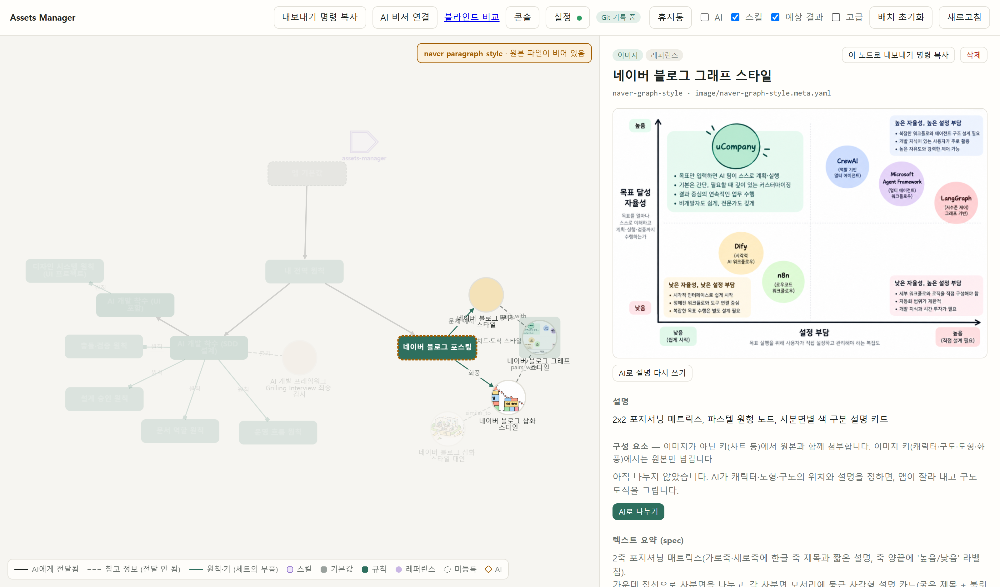
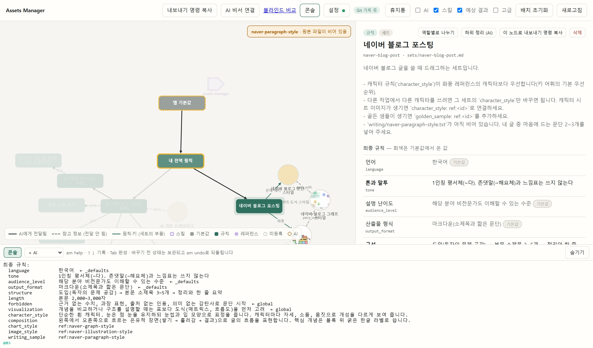

# Assets Manager

**내 작업 표준을 그래프로 관리하고, AI 앱에 끌어다 놓으면 그대로 따르게 만드는 로컬 데스크톱 앱**



AI에게 글이나 그림을 맡길 때마다 "이 말투로", "이 그림체로", "이건 쓰지 마"를 다시 적고 있었습니다.
Assets Manager는 그 지시를 **규칙**과 **레퍼런스 파일**로 한 번 정리해 두고, 작업할 때 노드 하나를 Codex·Claude·ChatGPT 창에 끌어다 놓으면 **조립된 프롬프트와 원본 파일**을 함께 넘겨 줍니다.

---

## 어떻게 쓰나

### 1. 규칙을 상속 그래프로 쌓는다



- **규칙 노드**(사각형): `앱 기본값 → 내 전역 원칙 → 네이버 블로그 포스팅`처럼 위에서 아래로 상속됩니다. 아래쪽 값이 이깁니다.
- **원칙 노드**: "설계 승인", "문서 역할"처럼 여러 세트가 부품으로 가져다 씁니다.
- **레퍼런스 노드**(원형): 그림·글·웹 원본 파일. 규칙 값으로 `ref:naver-graph-style`처럼 연결합니다.

### 2. 세트를 고르면 최종 규칙이 보인다



세트를 고르면 상속 경로가 강조되고, 오른쪽에 **조립된 최종 규칙**이 나옵니다. 각 값이 어디서 왔는지(`기본값`, `← global`)도 함께 표시됩니다.

### 3. 작업을 적고 AI 앱으로 끌어다 놓는다

맨 위 화면이 이 단계입니다.

1. 대상 앱(Codex, Claude 데스크톱, ChatGPT 웹)을 고릅니다.
2. 이번 작업을 한 줄 적습니다. 비슷한 과거 산출물이 있으면 참고 예시로 붙습니다.
3. 손잡이를 AI 앱 창에 끌어다 놓으면 `prompt.md`와 레퍼런스 원본이 함께 첨부됩니다.

앱마다 다른 첨부 한도(파일 수, 크기, 글자 수)를 넘으면 중요도가 낮은 것부터 자동으로 덜어냅니다.

<details>
<summary><b>실제로 넘어가는 프롬프트 보기</b> (일부 생략)</summary>

```markdown
# 작업 지침: 네이버 블로그 포스팅

아래 규칙과 첨부 레퍼런스를 함께 따르세요. 규칙이 첨부와 다르면 규칙을 우선합니다.

## 이번 작업
여름 휴가 준비 체크리스트 글

## 진행 방식: 계획을 먼저 보여 주고 승인을 받으세요
결과물을 바로 만들지 말고, 먼저 아래만 짧게 답한 뒤 사용자의 승인을 기다리세요.
1. 이번 작업을 어떻게 이해했는지 (한 줄)
2. 결과물 구성 (목차, 화면·파일 목록 등)
3. 이미지·도식 계획 (어디에, 무엇을, 몇 개)
4. 시작하기 전에 확인이 필요한 것 (없으면 "없음")
...

## 규칙
- **언어**: 한국어로 작성하세요.
- **톤과 말투**: 1인칭 평서체(~다). 존댓말(~해요체)과 느낌표는 쓰지 않는다
- **구성**: 도입(독자의 문제 공감) → 본문 소제목 3~5개 → 정리와 한 줄 요약
- **분량**: 본문 2,000~3,000자
- **금지 사항**: 근거 없는 수치, 과장 표현, 출처 없는 인용, 의미 없는 감탄사로 문단 시작
- **차트·도식 스타일**: 도식이나 차트가 필요하면 첨부 [1] naver-graph-style.png의 형태를 따르세요.
...

## 첨부 레퍼런스
- [1] naver-graph-style.png — 네이버 블로그 그래프 스타일
- [2] naver-illustration-style.png — 네이버 블로그 삽화 스타일
- [3] blog_style_image_2.png — 네이버 블로그 삽화 스타일 대안

## 이미지 생성 (ImageGen 요청서)
...

## 출력 전 자가 점검
- [ ] 처음부터 끝까지 말투가 한 가지로 유지되는가
- [ ] 금지 사항에 해당하는 표현이 하나도 없는가
- [ ] 도식의 레이아웃과 라벨 배치가 차트 레퍼런스와 같은 방식인가
- [ ] 계획에 적지 않은 규칙까지 위 규칙과 첨부 레퍼런스를 모두 지켰는가
...
```

</details>

### 레퍼런스는 원본 그대로



이미지 스타일은 글로 바꿔 설명하지 않고 **원본 파일을 그대로 참조 이미지로** 넘깁니다. 새 파일을 창에 놓으면 AI가 메타 정보를 작성해 등록해 줍니다.

### 콘솔과 AI 탭



`am show`, `am set`, `am inherit` 같은 명령으로 노드를 보고 바꿉니다. AI 탭에서 Claude Code를 열면 AI도 같은 명령으로 라이브러리를 고칩니다. 모든 변경은 `am undo`로 되돌릴 수 있습니다.

---

## 설계에서 지킨 것

| 원칙 | 뜻 |
|---|---|
| **결정적 조립** | 같은 폴더 상태와 같은 작업이면 글자 하나까지 같은 프롬프트. 조립에 AI 호출·난수·현재 시각을 쓰지 않습니다 |
| **앱은 AI API를 부르지 않음** | 해석은 외부 AI가 하고 결과는 파일(`plan.yaml`)로 돌아옵니다. 앱은 미리 보여 주고 사용자가 적용합니다 |
| **파일이 기준** | 규칙은 md, 레퍼런스는 원본 옆 `.meta.yaml`. 색인과 캐시는 언제든 다시 만듭니다 |
| **되돌릴 수 있게** | 변경 전 버전 보관, 휴지통, 라이브러리 Git 자동 커밋 |

전체 원칙(P1~P9)과 모듈 구조는 [설계 문서(SDD)](docs/SDD.md)에 있습니다.

## 기능 한눈에

- 다중 상속 + 부품 원칙 조립, 키 우선순위, 충돌 시 조립 중단 후 질문
- 대상 앱별 첨부 한도에 맞춘 자동 덜어내기 (첨부 → 글 → 컨택트 시트 → 제외)
- 승인 게이트: AI가 계획을 먼저 보여 주고 승인을 기다리게 하기
- 산출물 기록과 참고 예시, 골든 샘플
- AI가 만든 구조 변경은 전·후 그래프와 **최종 프롬프트 비교**를 본 뒤 적용
- MCP 서버(Claude 데스크톱), 스킬 내보내기(Claude Code·Codex), RAG JSONL 내보내기
- 로컬 임베딩 뜻 검색(선택, multilingual-e5-small ONNX)

## 기술 스택

| 영역 | 사용 |
|---|---|
| 코어 | Python 3 (표준 라이브러리 HTTP 서버, PyYAML, Pillow) |
| 데스크톱 | Tauri v2 (Rust), `tauri-plugin-drag`로 네이티브 파일 드래그 |
| UI | 빌드 단계 없는 바닐라 JS, Cytoscape.js, xterm.js |
| AI 연동 | MCP (stdio JSON-RPC), Claude Code·Codex CLI |
| 테스트 | `unittest` 107개 |

## 시작하기

앱은 **상위 폴더를 라이브러리로** 읽고 씁니다. 처음 실행하면 기본 규칙이 복사됩니다.

```
<라이브러리 폴더>/
  app/        ← 이 저장소
```

```powershell
# 라이브러리 폴더에서 (Python만 있으면 됨)
python -m pip install -r app\requirements.txt
python app\core\server.py        # → http://127.0.0.1:8765
```

데스크톱 모드(Tauri), 레퍼런스 등록, AI 결과 가져오기 등 자세한 사용법은 **[사용 안내](docs/USAGE.md)** 를 보세요.

## 라이선스

[MIT](LICENSE)
